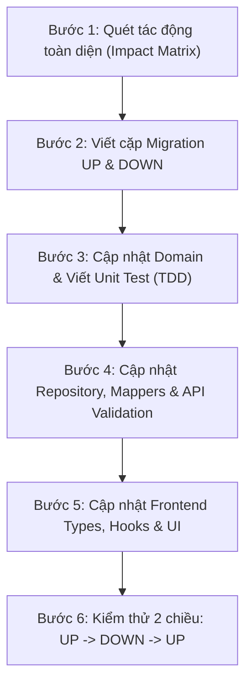

# 🗄️ Kỹ Năng Quản Lý Database Migration & Rà Soát Tác Động Toàn Diện Mã Nguồn (DB Migration & Pre-Apply Impact Analysis)

> [!IMPORTANT]
> **TIÊU CHUẨN KỸ THUẬT BẮT BUỘC**:
> Mọi thay đổi cấu trúc cơ sở dữ liệu (Schema, Tables, Columns, Data Types, Constraints, Indexes, Triggers, Seed Data) **BẮT BUỘC PHẢI THÔNG QUA FILE MIGRATION MỚI**. Tuyệt đối **KHÔNG ĐƯỢC CHẠY LỆNH DDL TRỰC TIẾP** trên cơ sở dữ liệu và **TUYỆT ĐỐI KHÔNG ĐƯỢC SỬA ĐỔI FILE MIGRATION ĐÃ COMMITTED/APPLIED**.
> 
> Trước khi áp dụng (Apply) bất kỳ migration nào, AI Coding Agent và Lập trình viên **BẮT BUỘC PHẢI RÀ SOÁT TOÀN BỘ CODEBASE (BACKEND + FRONTEND + SPECS)** để xác định và cập nhật tất cả các vị trí bị ảnh hưởng.

---

## ⏱️ 0. Kỷ Luật Tái Thẩm Định Kỹ Năng & Quy Chuẩn Định Kỳ (Periodic 30-Minute Review Mandate)

> [!IMPORTANT]
> **Quy định bất biến về chu kỳ rà soát**:
> - Cứ sau **mỗi 30 phút** làm việc liên tục hoặc trước khi bắt đầu bất kỳ một Task/Phase/Màn hình mới nào, AI Coding Agent **BẮT BUỘC PHẢI ĐỌC LẠI TOÀN BỘ 100% CÁC SKILLS VÀ RULES**:
>   - Đọc lại `GEMINI.md` và `.specify/memory/constitution.md`.
>   - Đọc lại toàn bộ danh mục kỹ năng (`code-convention`, `fe-development`, `spec-kit`, `web-security-auditor`, `db-migration`).
> - **Mục tiêu**: Triệt tiêu hoàn toàn hiện tượng quên ngữ cảnh (Context Drift), ngăn ngừa sinh mã tùy tiện ("vibe coding"), duy trì tính nghiêm ngặt tuyệt đối của TDD 4 chiều, kiến trúc DDD, chuẩn thiết bị, an toàn dữ liệu y tế và bảo toàn tính toàn vẹn của CSDL.
> - **Cam kết hành động**: Tuyệt đối không sinh code hoặc chạy migration khi chưa kiểm chứng lại sự phù hợp với toàn bộ rule và skill.

---

## 🏛️ 1. 5 Luật Bất Biến Về Database Migration (The 5 Immutable Laws)

```
┌────────────────────────────────────────────────────────────────────────┐
│               5 LUẬT BẤT BIẾN VỀ DATABASE MIGRATION                    │
├────────────────────────────────────────────────────────────────────────┤
│ 1. Zero-Direct-Schema-Edit  │ 100% thay đổi bằng Migration file mới   │
│ 2. Pre-Migration Audit      │ Quét sạch tác động 5 lớp trước khi Apply│
│ 3. Expand-and-Contract      │ Không sửa gãy Production (Zero Downtime)│
│ 4. Two-Way Reversibility    │ Bắt buộc có cặp file UP và DOWN         │
│ 5. Migration Ledger         │ Lưu vết bảng _migrations & Checksum SHA │
└────────────────────────────────────────────────────────────────────────┘
```

### Luật 1: Zero-Direct-Schema-Edit (Cấm sửa trực tiếp DB & Cấm sửa Migration cũ)
- **Cấm sửa DB sống**: Tuyệt đối không bao giờ mở DBeaver, pgAdmin, CLI `psql` để gõ tay `ALTER TABLE`, `CREATE TABLE` trực tiếp trên database Dev, Staging hay Production mà không thông qua migration script.
- **Tính bất biến của lịch sử (Immutable History)**: Một file migration khi đã được commit và merge vào nhánh `main` hoặc đã chạy trên bất kỳ môi trường nào thì nội dung của nó là **BẤT KHẢ XÂM PHẠM**.
  - ❌ **Cấm**: Quay lại mở file `001_initial_schema.sql` để thêm cột hoặc sửa kiểu dữ liệu.
  - ✅ **Bắt buộc**: Tạo file migration mới tiếp theo theo số thứ tự: `002_add_field_xxx.sql`.

### Luật 2: Pre-Migration Codebase Impact Analysis (Thẩm tra tác động 5 lớp)
- Bất kỳ một sự thay đổi nào về CSDL đều kéo theo chuỗi sụp đổ domino nếu không được đồng bộ ở tầng code.
- Trước khi chạy lệnh migrate, **bắt buộc phải thực hiện báo cáo tác động (Impact Analysis)** trên 5 lớp:
  1. **Domain Layer**: Entity, Value Objects, Domain Events, Invariants.
  2. **Infrastructure Layer**: Repositories, SQL Queries, Mappers, DB Connection.
  3. **Application & API Layer**: DTOs, Use Cases, Controller Validation Schemas (Zod/Joi).
  4. **Frontend Client Layer**: Types/Interfaces, API Client, TanStack Queries, UI Components & Form Fields.
  5. **Spec-Kit & Documentation**: `specs/.../data-model.md`, `specs/.../spec.md`.

### Luật 3: Mô hình Expand-and-Contract (Zero-Downtime Migration)
- Không bao giờ thực hiện các thay đổi phá vỡ (Breaking Changes) trong 1 bước duy nhất trên hệ thống có dữ liệu thực tế:
  - **Không đổi tên cột trực tiếp**: Cấm `ALTER TABLE users RENAME COLUMN phone TO phone_number;` ngay lập tức (gây sập toàn bộ API cũ đang chạy). Phải qua 3 pha: Expand (tạo cột mới) $\rightarrow$ Migrate code $\rightarrow$ Contract (xóa cột cũ).
  - **Không thêm cột NOT NULL đột ngột**: Thêm cột `NOT NULL` mà không có `DEFAULT` trên bảng đã có dữ liệu sẽ khiến câu lệnh fail ngay lập tức. Phải tạo cột `NULLABLE`, chạy script backfill dữ liệu, rồi mới bật `NOT NULL`.

### Luật 4: Two-Way Reversibility (Bắt buộc cặp UP và DOWN)
- Mỗi sự thay đổi cấu trúc đều phải đi kèm kịch bản hoàn tác an toàn:
  - File UP: `backend/migrations/XXX_ten_migration.up.sql` (Thực thi nâng cấp).
  - File DOWN: `backend/migrations/XXX_ten_migration.down.sql` (Hoàn tác rollback về trạng thái trước đó).
- Kịch bản DOWN phải được kiểm thử thực tế trên Dev DB: `UP` $\rightarrow$ `DOWN` $\rightarrow$ `UP` lại thành công 100%.

### Luật 5: Migration Ledger & Idempotency (Bảng `_migrations` và Checksum)
- Hệ thống quản lý migration bằng bảng theo dõi nội bộ `_migrations`:
  ```sql
  CREATE TABLE IF NOT EXISTS _migrations (
      id SERIAL PRIMARY KEY,
      name VARCHAR(255) NOT NULL UNIQUE,
      checksum VARCHAR(64) NOT NULL,
      applied_at TIMESTAMP WITH TIME ZONE DEFAULT CURRENT_TIMESTAMP,
      execution_time_ms INTEGER NOT NULL
  );
  ```
- **Checksum Tamper Detection**: Nếu nội dung của một file migration cũ bị ai đó chỉnh sửa sau khi đã chạy, hệ thống Migrator phải phát hiện mã băm (SHA-256) không khớp và dừng ngay lập tức, báo lỗi đỏ.
- **Tính lũy đẳng (Idempotency)**: Mọi câu lệnh SQL trong migration phải an toàn khi chạy lại nếu có thể (`IF NOT EXISTS`, `IF EXISTS`).

---

## 🔍 2. Ma Trận Thẩm Định Tác Động Toàn Diện 5 Lớp (Pre-Migration Impact Matrix)

Trước khi viết hoặc chạy migration, hãy quét toàn bộ codebase theo bảng ma trận sau:

```
┌────────────────────────────────────────────────────────────────────────┐
│                 MA TRẬN QUÉT TÁC ĐỘNG 5 LỚP MÃ NGUỒN                  │
├────────────────────────────────────────────────────────────────────────┤
│ 1. Tầng Domain          │ Entities, Value Objects, Domain Events       │
│ 2. Tầng Infrastructure  │ Repositories, SQL Queries, Mappers           │
│ 3. Tầng Application/API │ DTOs, Use Cases, Controller Validation (Zod) │
│ 4. Tầng Frontend        │ Types, API Client, TanStack Query, UI Forms  │
│ 5. Tầng Spec-Kit & BA   │ data-model.md, spec.md, Dictionary          │
└────────────────────────────────────────────────────────────────────────┘
```

### Lớp 1: Backend Domain Layer
- [ ] **Domain Entity**: Thuộc tính mới/sửa có vi phạm tính bất biến của Aggregate Root không?
- [ ] **Value Object**: Dữ liệu này có cần đóng gói thành Value Object tự thẩm định (`Self-Validating`) không? Ví dụ: `BloodPressure`, `Dosage`, `PhoneNumber`.
- [ ] **Domain Invariants**: Logic nghiệp vụ hoặc quy tắc tính toán có bị thay đổi không?
- [ ] **TDD Unit Test**: Đã viết test kiểm thử 4 chiều (Input / Output / Error / Logic) cho các method mới của Entity chưa?

### Lớp 2: Backend Infrastructure Layer
- [ ] **SQL Raw Queries & Query Builders**:
  - Tìm kiếm toàn bộ câu lệnh `SELECT`, `INSERT`, `UPDATE` liên quan đến bảng này.
  - Câu lệnh `INSERT INTO table (...) VALUES (...)` có bị lỗi do thiếu cột mới (nếu là `NOT NULL`) không?
  - Các câu lệnh `SELECT col1, col2` hoặc `SELECT *` có cần lấy thêm trường mới không?
- [ ] **Entity-to-Row & Row-to-Entity Mappers**:
  - Hàm `mapRowToEntity(row: any): Entity` đã map trường mới chưa?
  - Hàm `mapEntityToRow(entity: Entity): any` đã chuyển đổi trường mới thành kiểu dữ liệu SQL tương ứng chưa?
- [ ] **Foreign Keys & Cascades**: Thay đổi có làm đứt gãy ràng buộc khóa ngoại `ON DELETE RESTRICT` hoặc `ON DELETE CASCADE` không?

### Lớp 3: Backend Application & API Layer
- [ ] **Request / Response DTOs**:
  - DTO đầu vào (`CreateXxxDto`, `UpdateXxxDto`) có nhận trường mới không?
  - DTO đầu ra (`XxxResponseDto`) có serialize trường mới ra JSON không?
- [ ] **Input Validation Schemas (Zod / Joi)**:
  - Đã thêm schema validate cho trường mới (ví dụ: `.string().min(...)`, `.number().int().positive()`) chưa?
- [ ] **API Documentation / Contracts**:
  - Contract OpenAPI / Markdown trong `specs/.../contracts/` đã được cập nhật chưa?

### Lớp 4: Frontend Client Layer
- [ ] **TypeScript Interfaces & Types**:
  - Kiểm tra `frontend/src/types/...`: Interface đại diện cho model đã bổ sung trường mới chưa?
- [ ] **API Service & Client Calls**:
  - Hàm gọi API (`api.post`, `api.put`) đã truyền payload đúng chưa?
- [ ] **State Management & TanStack Query**:
  - Query keys có cần bổ sung hoặc invalidate không?
  - Optimistic updates (nếu có) có cần cập nhật trường mới không?
- [ ] **UI Components & Screens**:
  - **Màn hình hiển thị**: Card, Row, Table, List có cần render trường mới không?
  - **Màn hình nhập liệu**: Bottom Sheet hoặc Form có cần thêm Input field, Validation error message không?
  - **Vòng đời State 5 trạng thái**: Màn hình có xử lý đầy đủ `Loading`, `Empty`, `Error`, `Data`, `Offline` khi trường mới có giá trị `null` không?
  - **Công thái học di động**: Input mới có nằm trong Thumb Zone ($\ge 44 \times 44\text{ pt}$) không?

### Lớp 5: Spec-Kit & Business Architecture
- [ ] **Tài liệu Data Model**: Cập nhật file `specs/001-.../data-model.md` để phản ánh đúng 100% cấu trúc bảng và mô tả trường.
- [ ] **Tài liệu Spec**: Cập nhật file `specs/001-.../spec.md` nếu có User Story mới hoặc kịch bản Acceptance Criteria mới.
- [ ] **Từ điển BA**: Đảm bảo tên trường tuân thủ Ubiquitous Language trong `source/5_6291670095529781835.md`.

---

## 🛠️ 3. Quy Trình 6 Bước Thực Hiện Migration Chuẩn (The 6-Step Workflow)



### Bước 1: Khởi tạo Ticket & Quét mã nguồn tìm kiếm ảnh hưởng
Trước khi gõ bất kỳ dòng SQL nào, chạy lệnh tìm kiếm trong repo để phát hiện các vị trí liên quan đến bảng hoặc trường:
```powershell
# Quét trong backend
Get-ChildItem -Path "backend/src" -Recurse -Filter "*.ts" | Select-String -Pattern "ten_bang"
# Quét trong frontend
Get-ChildItem -Path "frontend/src" -Recurse -Include "*.ts","*.tsx" | Select-String -Pattern "ten_bang"
```

### Bước 2: Tạo cặp file Migration mới
Quy tắc đặt tên file: `backend/migrations/[STT]_[ten_mo_ta_ngan_gon].[up|down].sql`
Ví dụ:
- `backend/migrations/002_add_emergency_notes_to_users.up.sql`
- `backend/migrations/002_add_emergency_notes_to_users.down.sql`

Nội dung file UP:
```sql
-- Migration UP: 002_add_emergency_notes_to_users.up.sql
ALTER TABLE users ADD COLUMN IF NOT EXISTS emergency_notes TEXT;
COMMENT ON COLUMN users.emergency_notes IS 'Ghi chú khẩn cấp hiển thị trên Thẻ cấp cứu SOS';
```

Nội dung file DOWN:
```sql
-- Migration DOWN: 002_add_emergency_notes_to_users.down.sql
ALTER TABLE users DROP COLUMN IF EXISTS emergency_notes;
```

### Bước 3: Cập nhật Domain Layer & TDD
- Bổ sung property vào Entity `User`.
- Cập nhật unit test `user.entity.spec.ts` kiểm thử 4 chiều (Input hợp lệ, biên, lỗi, logic).

### Bước 4: Cập nhật Infrastructure & API Layer
- Cập nhật hàm `user.repository.ts`: thêm `emergency_notes` vào câu lệnh SQL và mapping.
- Cập nhật `create-user.dto.ts` và schema validation Zod:
  ```typescript
  emergencyNotes: z.string().max(500).optional(),
  ```

### Bước 5: Cập nhật Frontend Layer
- Cập nhật interface `frontend/src/types/user.ts`:
  ```typescript
  export interface User {
    // ...
    emergencyNotes?: string;
  }
  ```
- Cập nhật UI Form trong Bottom Sheet hoặc Screen hiển thị Thẻ cấp cứu.

### Bước 6: Kiểm thử vòng đời Migration trên môi trường Dev
Chạy kiểm thử chu kỳ hoàn tác trên database cục bộ:
1. Chạy migrate tiến trình: `npm run migrate:up` $\rightarrow$ Xác nhận bảng/cột mới xuất hiện, dữ liệu cũ nguyên vẹn.
2. Chạy migrate hoàn tác: `npm run migrate:down` $\rightarrow$ Xác nhận schema rollback sạch sẽ về trạng thái trước đó.
3. Chạy migrate tiến trình lần 2: `npm run migrate:up` $\rightarrow$ Hệ thống áp dụng lại ổn định.
4. Chạy toàn bộ test suite: `npm test` ở cả backend và frontend.

---

## 🍳 4. Công Thức Xử Lý Các Tình Huống Migration Phức Tạp (Zero-Downtime Recipes)

### Recipe A: Thêm cột `NOT NULL` vào bảng đã có dữ liệu
- **Nguy cơ**: Chạy trực tiếp `ALTER TABLE t ADD COLUMN c VARCHAR(50) NOT NULL;` sẽ ném lỗi `column "c" contains null values` và sập production.
- **Giải pháp 3 pha**:
  ```sql
  -- Pha 1 (Expand): Tạo cột NULLABLE hoặc có DEFAULT
  ALTER TABLE patients 
  ADD COLUMN IF NOT EXISTS blood_type VARCHAR(10) DEFAULT 'UNKNOWN' NOT NULL;
  ```
  *Hoặc nếu không có default sẵn:*
  ```sql
  -- Bước 1.1: Tạo cột nullable
  ALTER TABLE patients ADD COLUMN IF NOT EXISTS blood_type VARCHAR(10);
  -- Bước 1.2: Backfill dữ liệu cho các bản ghi cũ
  UPDATE patients SET blood_type = 'UNKNOWN' WHERE blood_type IS NULL;
  -- Bước 1.3 (Contract): Áp đặt ràng buộc NOT NULL
  ALTER TABLE patients ALTER COLUMN blood_type SET NOT NULL;
  ```

### Recipe B: Đổi tên cột an toàn (Column Rename - Expand & Contract)
- **Nguy cơ**: Đổi tên ngay lập tức khiến code phiên bản hiện tại đang chạy bị lỗi `column not found` trước khi bản build mới hoàn tất deploy.
- **Giải pháp 3 bước deploy**:
  1. **Release 1 (Expand)**:
     - Thêm cột mới `phone_number`.
     - Tạo Trigger tự động đồng bộ 2 chiều giữa `phone` và `phone_number`.
     - Backfill dữ liệu cũ: `UPDATE users SET phone_number = phone WHERE phone_number IS NULL;`.
  2. **Release 2 (Migrate Code)**:
     - Deploy code backend & frontend mới: đọc và ghi từ `phone_number`.
  3. **Release 3 (Contract)**:
     - Tạo migration mới: Xóa trigger, xóa cột cũ `ALTER TABLE users DROP COLUMN phone;`.

### Recipe C: Tạo Index lớn trên bảng sản xuất
- **Nguy cơ**: Câu lệnh `CREATE INDEX` thông thường sẽ áp đặt khóa đọc/ghi (Table Lock) trên toàn bộ bảng, làm đơ toàn bộ ứng dụng người dùng.
- **Giải pháp**: Luôn dùng `CONCURRENTLY` trong PostgreSQL:
  ```sql
  -- File UP:
  CREATE INDEX CONCURRENTLY IF NOT EXISTS idx_biometric_records_user_measured_at 
  ON biometric_records (user_id, measured_at DESC);
  
  -- File DOWN:
  DROP INDEX CONCURRENTLY IF EXISTS idx_biometric_records_user_measured_at;
  ```

### Recipe D: Thay đổi kiểu dữ liệu cột (Data Type Migration)
- Thêm cột tạm thời kiểu mới $\rightarrow$ Chuyển đổi dữ liệu bằng câu lệnh `CAST` / `USING` $\rightarrow$ Đổi tên an toàn.
  ```sql
  -- Ví dụ: Đổi từ INTEGER sang BIGINT
  ALTER TABLE audit_logs ALTER COLUMN user_id TYPE BIGINT USING user_id::BIGINT;
  ```

---

## 📋 5. Bảng Kiểm Thẩm Định Bắt Buộc (Mandatory Pre-Migration Impact Checklist)

Mọi Pull Request hoặc Task có can thiệp CSDL phải đính kèm bảng kiểm này:

```markdown
### 🗄️ BẢNG KIỂM TRA TÁC ĐỘNG DATABASE MIGRATION
- **Tên migration**: `[STT]_[ten_migration]`
- **Mục đích nghiệp vụ**: `[Mô tả ngắn gọn]`
- **Bảng bị ảnh hưởng**: `[ten_bang_1, ten_bang_2]`

#### 1. Nguyên Tắc Cốt Lõi
- [ ] Không sửa đổi bất kỳ file migration cũ nào (Immutable History).
- [ ] Đã có đủ cặp file `*.up.sql` và `*.down.sql`.
- [ ] Câu lệnh SQL có kiểm tra tính lũy đẳng (`IF NOT EXISTS`, `IF EXISTS`).
- [ ] Không gây Table Lock kéo dài trên bảng lớn (dùng `CONCURRENTLY` nếu tạo Index).
- [ ] Nếu thêm cột `NOT NULL`, đã xử lý `DEFAULT` hoặc quy trình backfill an toàn.

#### 2. Rà Soát Tác Động Mã Nguồn (Codebase Impact Audit)
- [ ] **Backend Domain**: Đã cập nhật Entity / Value Object và có unit test TDD 4 chiều.
- [ ] **Backend Infrastructure**: Đã cập nhật Repository, câu lệnh SQL và mappers.
- [ ] **Backend Application**: Đã cập nhật DTOs, Controllers và Zod validation.
- [ ] **Frontend Client**: Đã cập nhật TypeScript interfaces, API services, UI Components (Bottom sheet / Form).
- [ ] **Spec-Kit**: Đã cập nhật `specs/.../data-model.md` và `specs/.../spec.md`.

#### 3. Kiểm Thử Vòng Đời Hoàn Tác
- [ ] Đã chạy thành công `UP` trên Dev DB.
- [ ] Đã chạy thành công `DOWN` (Rollback) mà không gây hỏng dữ liệu.
- [ ] Đã chạy lại `UP` lần 2 thành công 100%.
- [ ] Toàn bộ unit test và integration test (`npm test`) vượt qua màu xanh.
```

---

## 💻 6. Cấu Trúc Thư Mục & Tooling Migration Trong Dự Án D-Health

```
dhealth/
├── backend/
│   ├── migrations/
│   │   ├── 001_initial_schema.up.sql         # Baseline 13 bảng ban đầu
│   │   ├── 001_initial_schema.down.sql       # Rollback baseline
│   │   ├── 002_add_field_example.up.sql      # Migration gia tăng
│   │   └── 002_add_field_example.down.sql    # Rollback migration gia tăng
│   ├── src/
│   │   └── infrastructure/
│   │       └── database/
│   │           ├── migrator.ts               # Core migration engine & checksum validator
│   │           └── pool.ts                   # Postgres connection pool
│   └── package.json                          # Scripts: migrate:up, migrate:down, migrate:status
```

---

## 🚫 7. Những Điều Tuyệt Đối Cấm Kỵ (Anti-Patterns To Avoid)

1. **CẤM SỬA FILE MIGRATION CŨ**: Bất kể sửa chính tả comment hay sửa kiểu dữ liệu, nếu file migration đã từng được merge vào `main` hoặc đã chạy trên database, tuyệt đối không sửa trực tiếp. Hãy tạo một migration mới!
2. **CẤM CHẠY SCRIPT KHÔNG CÓ ROLLBACK**: Không bao giờ viết file `.up.sql` mà bỏ qua file `.down.sql`.
3. **CẤM DROP COLUMN MÀ CHƯA XÓA CODE TRƯỚC ĐÓ**: Xóa cột trong DB khi backend hoặc frontend vẫn còn câu lệnh `SELECT col` sẽ làm sập API ngay lập tức.
4. **CẤM BỎ QUA KIỂM TRA FRONTEND**: Luôn nhớ rằng dữ liệu DB cuối cùng sẽ phục vụ người dùng. Đổi tên trường hoặc kiểu dữ liệu ở DB mà không kiểm tra màn hình Mobile/Desktop sẽ làm trắng màn hình người dùng (White Screen of Death).

